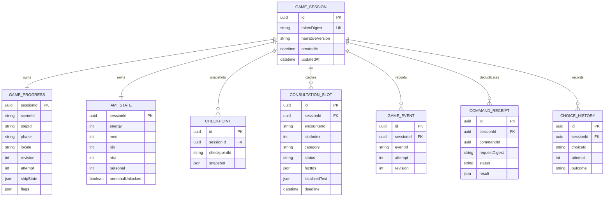

# Domain model and state transitions

## Current domain status

Four migrations are deployed locally: durable sessions/receipts, checkpoints/slots, and pending-generation reservation support. CP-DOG/CP-RAT and immutable slots, Chapter 3/4 snapshots and replay high-water are persisted. F1/F2/F3 atomically restore energy/memory, F3 unlocks PERSONAL. Chapter 4 uses an optional marker with shared authoritative cursor, revision, diagnostics and events; no new schema migration. CP-BOAR and Chapter 5 remain pending. Historical target diagrams below are specifications, not complete runtime schema documentation.

**Current accepted baseline — November 18, 2026 (Belém; November 19 UTC):** Chapters 1–4 owner-approved (4/5, 80%); formal AMI issues 7/13 (53.8%) closed, plus release follow-up #29 completed. F3 restores all four memory indexes and energy atomically, PERSONAL unlocked. Original twelve assets retained; Master v1.13 / Script v1.11 and later approved amendments remain authoritative. PR #28 merged `176e8c1`, visual refinements #32/#33 `23b165e`/`eb13de4`; AI diversity #35 `f9c89c9` and expanded pool #36 `ec61f29` merged after owner acceptance and exact-head CI 44426011328/44428871649. Local port 3000 installed `ec61f29` with Qwen2.5:1.5b (65ec06548149), Ollama internal-only, 24 authorized bilingual RANDOM options, at most three sampled, exact validation, unchanged 15/42/100 probability, energy, immutable slots, recipe metadata and 2 s/2.5 s deadlines. Direct expanded benchmark 81/82 with 21/24 distinct; browser 7/7, DOG three distinct RANDOM and RAT mixed categories. Latest live log 10/10 direct regression, two sessions retained, verified pre-expanded backup, API/AI/DB healthy and web starting immediately after restart. No new migrations or paid resources. Chapter 5 draft #30 `ffb28db` isolated domain/catalog CI 44421224642 green, not integrated; reconcile with current main before CP-BOAR, engine, persistence, UI, final dialogue and credits. Full campaign QA, deployment, final docs and release remain open. See development handoff for safe pause/resume; historical snapshots do not supersede this baseline.

---

**Target schema for AMI-004/005/006.** Merged PR #20 implements an incremental GameSession migration (version, JSON state, token digest, revision, expiry) and GameCommandReceipt, while preserving existing rows. Merged PR #22 adds GameCheckpoint and GameConsultationSlot for CP-DOG. The ER diagram remains the target for the remaining models, not a claim that every table exists. The design preserves the canonical script (Master v1.12 / Script v1.10).

## ER diagram

### Chapters 1–3 implemented subset

The session's JSON state stores the current step, review cursor, locale, event flags, diagnostics and free INTRO fallback; only server mutations write it. An additive migration leaves legacy identity-only rows non-resumable. PostgreSQL row locking and receipts serialize commands; the receipt stores a request digest and applied revision, not a stale projection. PR #22 adds dedicated transactional checkpoint and resolved-slot tables for CP-DOG; the pure engine retains a JSON checkpoint and slot cache persisted atomically with normalized records and receipts. Provider reservation/finalization and later encounters remain pending.

### Data invariants

- Session ID and session token are different values. Session capability is generated by the server. Store a digest, not the token; unique session token digest. Use a stable narrative version per run.
- Progress has a monotonic revision and attempt identifier. A mutation transaction locks/compares the current revision, authorizes the command, writes state/event/receipt together. Unique (sessionId, commandId) and payload hash distinguish retry from conflicting reuse.
- AMI energy 0..3; UI hidden until E-JOIN. Memory values are fixed by restoration stage (below). Flags in snapshots use a versioned schema; do not accept client snapshots. Model shape may be normalized further when implementing migration.
- Unique (sessionId, checkpointId); snapshot captured once at canonical entry before encounter. Restore progress, energy, memory, event flags, ship and temporary choices on explicit retry. Revision, attempt counters, audit/command receipts and consultation slots do not roll back.
- Unique (sessionId, encounterId, slotIndex), slots 1..3; INTRO-RANDOM uses separate identifier and index 0. Store category once, reserve and finalize transactionally. A known slot reused in a new attempt costs one restored bar; it never triggers inference again. Language change never changes category, facts or slot assignment.
- Track per-attempt consultation count and categories independently of all-time slot cache. On safe choice choose post-success variant from the current attempt. Keep historical choices and events for diagnostics without exposing them as gameplay state.
- Single-run one-time events and ordered transitions cannot be applied twice; enforce constraints and state checks together. Rollback does not erase prior permanent restoration/recharge events.
- A pending consultation has a deadline; recover to localized fallback on timeout without reroll. Provider failures must not leave energy permanently stuck or invoke another debit.
- No inventory, item tables, weapons, hit points or alternate campaign endings.

## Canonical scene transition table

| Scene | Mandatory exit gate | Next |
| --- | --- | --- |
| A01-S01 | Authored awakening and exit | A01-S02 |
| A01-S02 | Follow described melody | A01-S03 |
| A01-S03 | E-JOIN, orientation, INTRO-RANDOM, MEM-D1 / FB-D1 | A02-S01 / CP-DOG |
| A02-S01 | Four DOG choices; safe DOG-04 | A02-S02 or dead → CP-DOG |
| A02-S02 | F1 (memory and energy), MEM-D2 / FB-D2, E-NAME | A03-S01 |
| A03-S01 | E-ARCHIVE, E-PLANET, E-PARTNER, MEM-D3 / FB-D3 | A03-S02 / CP-RAT |
| A03-S02 | Four RAT choices; safe RAT-02 | A03-S03 or dead → CP-RAT |
| A03-S03 | F2 (memory and energy), E-ESCAPE-ROUTE | A04-S01 |
| A04-S01 | F3, E-F3, manual / PERSONAL unlock | A04-S02 |
| A04-S02 | E-FAMILY, MEM-D4 / FB-D4-D5, E-BETRAYAL, E-PAST-RESTORED | A05-S01 |
| A05-S01 | E-SHIP, CP-BOAR, four BOAR choices; safe BOAR-04 / E-LAUNCH | A05-S02 or dead → CP-BOAR |
| A05-S02 | Authored final, E-COMPLETE | Credits → menu |

Order within each gate comes from the source script; this table does not reorder dialogue or events. All other encounter choices are lethal. Checkpoints are retry destinations, not alternate scenes. Line identifiers repeat across scenes; use composite (sceneId, lineId) in the catalog. The approved opening uses SILENCE, L01a and L01b as presentation beats within A01-S01, retaining later line IDs. Chapter 1 read-only history spans reached presentation from L02 through the Chapter 2 handoff, including applied events, without rewinding authoritative state; diagnostics are not projected for reviewed beats before E-JOIN. Initial card and dark opening are excluded from new PREVIOUS commands.

## Memory and energy invariants

| Stage | MED-01 | BIO-02 | HIST-03 | PERSONAL | Unlock |
| --- | ---: | ---: | ---: | ---: | --- |
| Initial | 10 | 15 | 12 | 5 | No |
| F1 | 35 | 42 | 53 | 5 | No |
| F2 | 75 | 85 | 78 | 5 | No |
| F3 | 100 | 100 | 100 | 100 | Yes |

| Snapshot | Energy | Memory stage | Other prerequisites |
| --- | ---: | --- | --- |
| CP-DOG | 3 | Initial | E-JOIN |
| CP-RAT | 3 | F1 | F1 recharge, historical records |
| CP-BOAR | 3 | F3 | F3 recharge, E-SHIP, gate closed, propulsion off |

CORRECT probability uses the BIO-02 stage at encounter start: 15/42/100%. F3 guarantees CORRECT. The success variants are A (only RANDOM), B (at least one CORRECT), C (no consultations); boar cannot have A. F1/F2 atomically restore energy to 3 with memory; planned F3 follows the same rule. SOL-01/SOL-02 are legacy-only. INTRO-RANDOM is independent of the energy bar count and optional provider generation.

## Catalog and asset authorization

Use 12 narrative scene IDs and 12 separate image IDs. Reuse images within scenes and memory blocks as defined in the source asset catalog. The server derives currently allowed asset ID and alt text from the current step, not a client-supplied scene. Do not serialize future scene catalog, answers, secret identities, fact records or unrevealed images. The 9 reference sheets stay in Drive.

## Testing strategy

Pure engine tests: all 12 choices, every required event, restoration values, random bounds, zero energy, invalid action. Integration tests: duplicate command IDs, conflicting revision, simultaneous consultation/choice, cross-session access, pending timeout, snapshot restoration and restart. Contract tests: strictly typed request and sanitized response; provider offline/invalid fallback. E2E: both languages, all deaths, direct success, mixed consultations, final credits. Do not claim execution before corresponding code exists.

Day 2 acceptance: PR #22 merged at `76946f9` on November 17, 2026 after owner approval of PT-BR, EN and mobile playtests. Final [branch CI 44122437473](https://github.com/AlexandroLeao/ami-108/actions/runs/44122437473) and [post-merge CI 44124197244](https://github.com/AlexandroLeao/ami-108/actions/runs/44124197244) passed (46 API, 17 web, 1 Python tests; three migrations, lint/type checks, builds and built HTTP smoke including original artwork hashes). The additive CP-DOG/slot migration and row-locked receipt transaction are verified; replay retains unlocked high-water and resolved slots. F1/SOL-01 are implemented, later F2/F3/SOL-02, rat/boar and provider reservation/finalization remain pending. AMI-006 is not complete.
