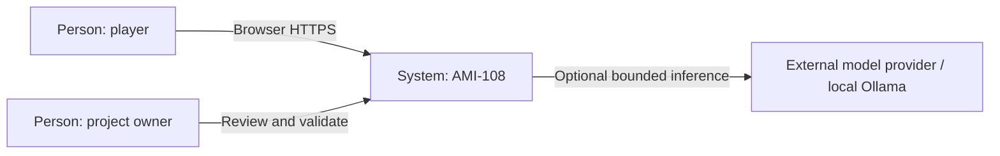
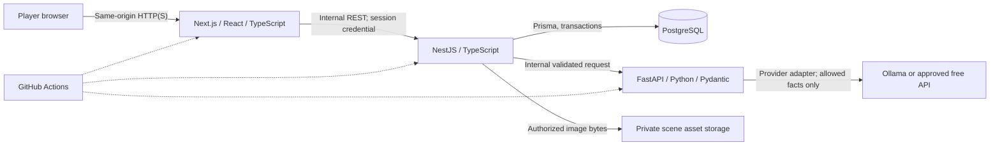
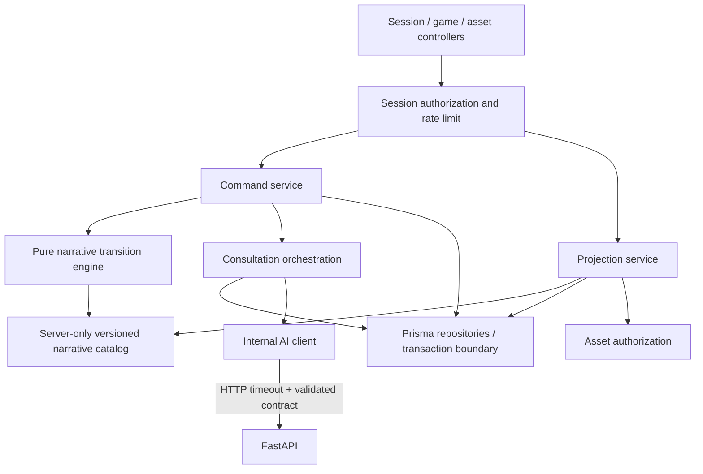
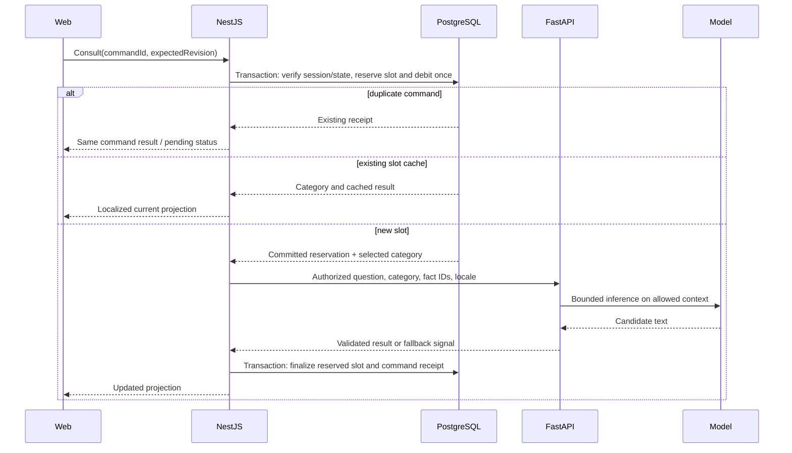
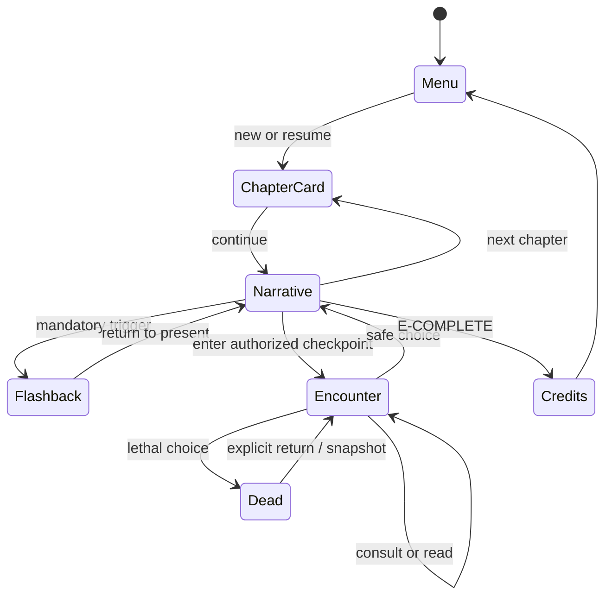

# System design

**AMI-002 · proposed implementation design for review**  
Canonical narrative: Documento Mestre v1.9 / Roteiro Interativo v1.7 (private backup). See [requirements](requirements.md), [domain model](domain-model.md), [decisions](decisions.md) and [API contracts](../api/README.md).

## C4 level 1 — system context

## C4 level 2 — containers

Browser requests go through the web origin; Next route handlers proxy the game API without exposing the internal service URL or secrets. NestJS validates session ownership and current state for every read and mutation. PostgreSQL is the sole durable authority. FastAPI is internal, stateless with respect to game state, and never chooses outcomes. Local storage for derived image files is sufficient for the MVP; S3 is conditional, not a current dependency. Public URLs and bundled assets are not access control. Stream authorized image bytes through the game API; no future scene assets under public web directories.

## C4 level 3 — NestJS components

Implement pure deterministic domain functions before framework adapters. Inject RNG and provider/client dependencies for tests. Keep scene data, exact outcomes, reveal policies and fallback text in server-only modules. UI only renders a projection of the current screen, not arbitrary scene selection. The existing health endpoints remain diagnostics.

## Deployment and environments

- Observed baseline: local Compose, four healthy services, Node 22 and Python 3.12, CI success, Google Cloud Shell preview; Codespaces config exists but is untested.
- Production candidate: same-origin web facade, private API/AI/database connections, HTTPS, secrets injected via environment, bounded request/logging policies; no resources provisioned.
- AWS and external provider use require explicit cost, eligibility, data policy and owner verification. CI/CD and OpenTofu are incremental deliverables.
- Temporary Cloud Shell volumes are not durable backups. Source code lives in GitHub; official narrative and art backups in Drive.

## UML sequence — consultation with reservation

Do not hold database locks during network inference. A pending slot has an explicit deadline and deterministic fallback recovery; retries reuse the reservation, not a new draw or debit. On timeout after an uncertain provider call, finalize with fallback rather than issue another inference. While pending, block conflicting mutations; retry the same command ID or read current status. No in-flight generation can mutate a later scene or attempt. Locale changes preserve the existing fact/category; missing translation uses authored fallback, not a new provider call.

## UML state — game screen lifecycle

This is a conceptual state machine, not an implementation. The concrete allowed events are in the canonical scene map and [domain model](domain-model.md). No skip endpoint, arbitrary scene jump, new branch of the campaign, or retry on a successful encounter.

## Security and operational boundaries

- Anonymous session capability: cryptographically random opaque token in secure HttpOnly SameSite cookie at the web boundary; store only a token digest. No account/password system required for MVP (proposal). Validate Origin on mutations, reject cross-origin requests, never trust client progress. Bind capability to one session.
- Only current allowed actions and current asset are visible. Generic unauthorized asset responses do not reveal whether future content exists. Set private/no-store cache policy for session projections and gated image responses.
- Never send the full script, personal data or future context to an external model. Service credentials remain server-side. Use a strict allowlist of fact IDs with question/category and narrative phase, validated output and fallback.
- Rate limit by session and conservative IP policy; cap session creation, body size and provider calls. No user-entered prompt field.
- Use correlation IDs, status/error codes and timing metrics without logging session tokens, prompt bodies or protected content.
- Liveness checks only process health; game readiness must not require an online LLM. AMI-001 readiness checks AI connectivity as a diagnostic; adjust degraded-mode policy during implementation.
