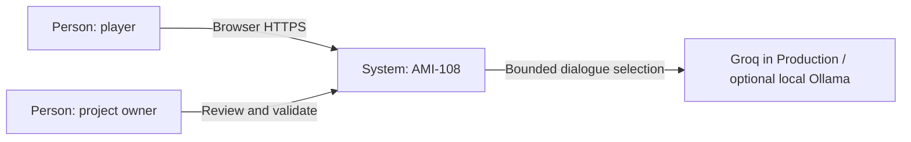
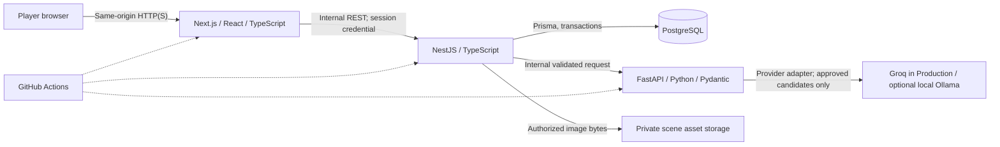
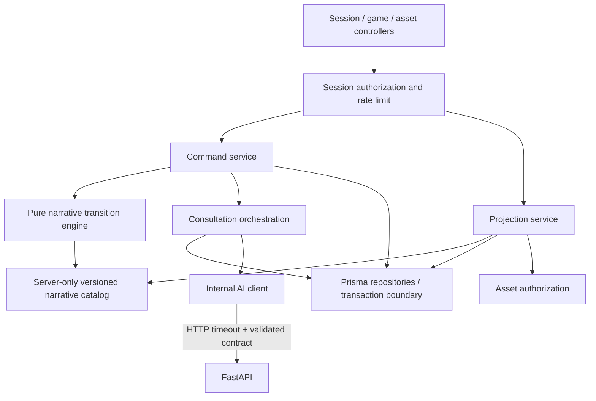
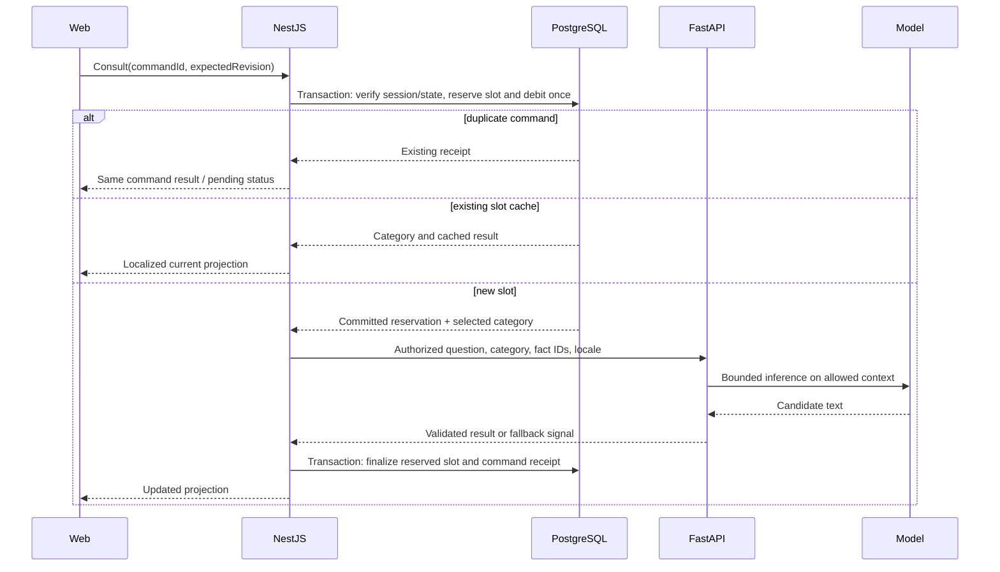
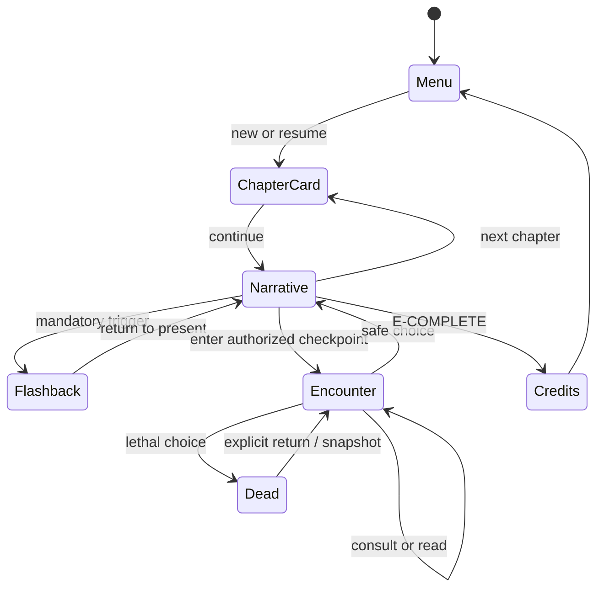

# System design

## Current implemented containers and boundary

NestJS is the authoritative gameplay service for all five chapters, DOG/RAT/BOAR, three checkpoints, immutable consultation slots, F1/F2/F3, replay and completion. FastAPI validates bounded inference, while Groq `openai/gpt-oss-20b` selects only approved dialogue and cannot change game outcomes. The public Vercel deployment uses private NestJS/FastAPI service connections and Neon PostgreSQL with five migrations and database-backed daily usage limits. The separate owner-accepted Cloud Shell environment remains safely paused, with optional local Ollama inference inactive. See [release readiness](../release-readiness-matrix.md) for dated Production and local-state evidence.

> **Archived PR #38 snapshot:** [historical evidence](../history-pr38-snapshot.md). For the latest verified seven-session pause and outstanding release gates, see [release readiness](../release-readiness-matrix.md).

---

**The diagrams below describe implemented service responsibilities. The original PR #17 design and subsequent milestones are historical context.**  
**Historical PR #17 source input:** Documento Mestre v1.12 / Roteiro Interativo v1.10 (private backup). **Current approved source precedence:** private Documento Mestre v1.14 and Roteiro Interativo v1.12, supplemented only by subsequent owner-approved amendments. See [requirements](requirements.md), [domain model](domain-model.md), [decisions](decisions.md) and [API contracts](../api/README.md).

## C4 level 1 — system context

## C4 level 2 — containers

Browser requests go through the web origin; Next route handlers proxy the game API without exposing the internal service URL or secrets. NestJS validates session ownership and current state for every read and mutation. PostgreSQL is the sole durable authority. FastAPI is internal, stateless with respect to game state, and never chooses outcomes. Local storage for derived image files is sufficient for the MVP; S3 is conditional, not a current dependency. Public URLs and bundled assets are not access control. Stream authorized image bytes through the game API; no future scene assets under public web directories.

## C4 level 3 — NestJS components

The domain engine is deterministic and server-side. The persisted session/receipt service, authorized NestJS endpoints and Next.js facade support all five chapters, three encounters and checkpoint replay. Keep outcome selection, private scene data, probability draws and fallback text under game-server authority. Inject randomness and provider dependencies for tests; the UI renders only the authorized current projection. Health endpoints are diagnostic, not proof of provider availability.

## Deployment and environments

- **Production:** Vercel Web with same-origin facade, private NestJS and FastAPI bindings, Groq inference and Neon PostgreSQL. The canonical game URL is public, while Preview and deployment-specific URLs remain protected. Five database migrations and UTC-day budgets were accepted for the portfolio release.
- **Local development:** Docker Compose on Google Cloud Shell, with separate persisted private backups. The last owner-verified local VM was safely paused with optional Ollama generation disabled. Cloud Shell volumes are not durable backups.
- **CI:** GitHub Actions validates code, tests, migration compatibility, documentation and campaign smoke. Do not infer public reliability or security certification from CI alone.

See [Vercel deployment verification](../vercel-deployment-preflight.md), [development guidance](../development.md) and [release readiness](../release-readiness-matrix.md).

## UML sequence — consultation with reservation

Do not hold database locks during network inference. A pending slot has an explicit deadline and deterministic fallback recovery; retries reuse the reservation, not a new draw or debit. On timeout after an uncertain provider call, finalize with fallback rather than issue another inference. While pending, block conflicting mutations; retry the same command ID or read current status. No in-flight generation can mutate a later scene or attempt. Locale changes preserve the existing fact/category; missing translation uses authored fallback, not a new provider call.

## UML state — game screen lifecycle

This is a conceptual state machine, not an implementation. The concrete allowed events are in the canonical scene map and [domain model](domain-model.md). No skip endpoint, arbitrary scene jump, new branch of the campaign, or retry on a successful encounter.

## Security and operational boundaries

- Anonymous session capability: cryptographically random opaque token in secure HttpOnly SameSite cookie at the web boundary; store only a token digest. No account/password system required for MVP (proposal). Validate Origin on mutations, reject cross-origin requests, never trust client progress. Bind capability to one session.
- Only current allowed actions and current asset are visible. Generic unauthorized asset responses do not reveal whether future content exists. Set private/no-store cache policy for session projections and gated image responses.
- Never send the full script, personal data or future context to an external model. Service credentials remain server-side. Use a strict allowlist of fact IDs with question/category and narrative phase, validated output and fallback.
- Public PostgreSQL admission budgets cap new sessions and provider attempts per UTC day. They do not cover every endpoint or concurrency mode; further abuse controls need independent validation. No user-entered prompt field.
- Use correlation IDs, status/error codes and timing metrics without logging session tokens, prompt bodies or protected content.
- Liveness checks prove process health, not model availability. When remote inference fails or exhausts its budget, authorized authored fallback preserves gameplay.

Dated early Chapter 1–2 design and CI milestones are preserved in [development history](../development-history.md), not treated as current deployment status.
